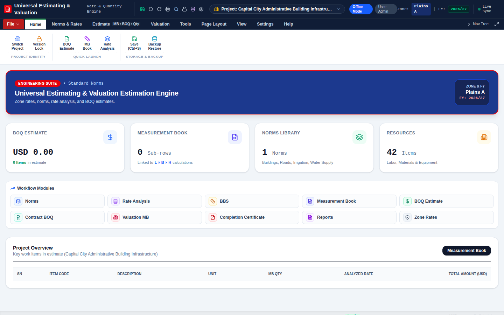
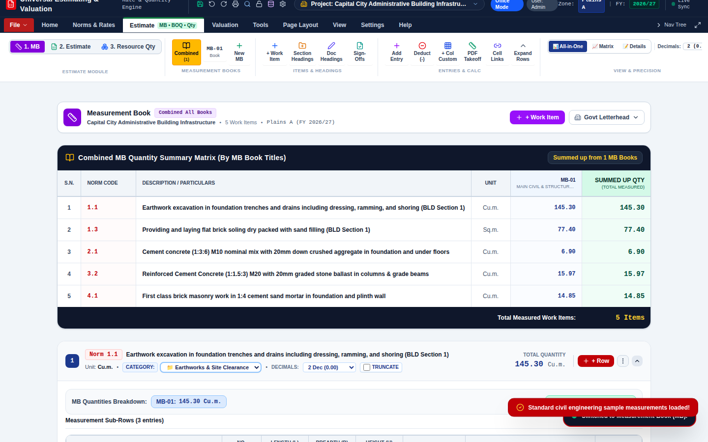
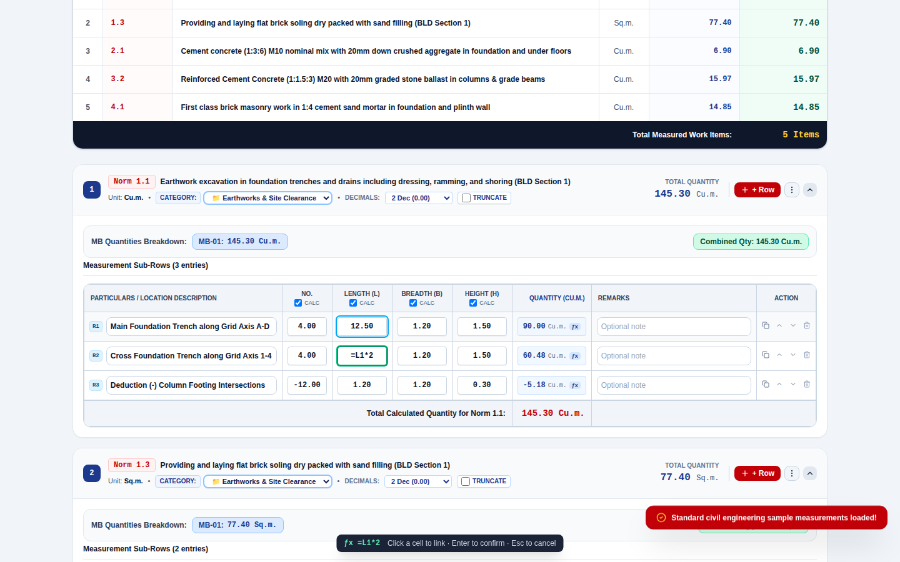
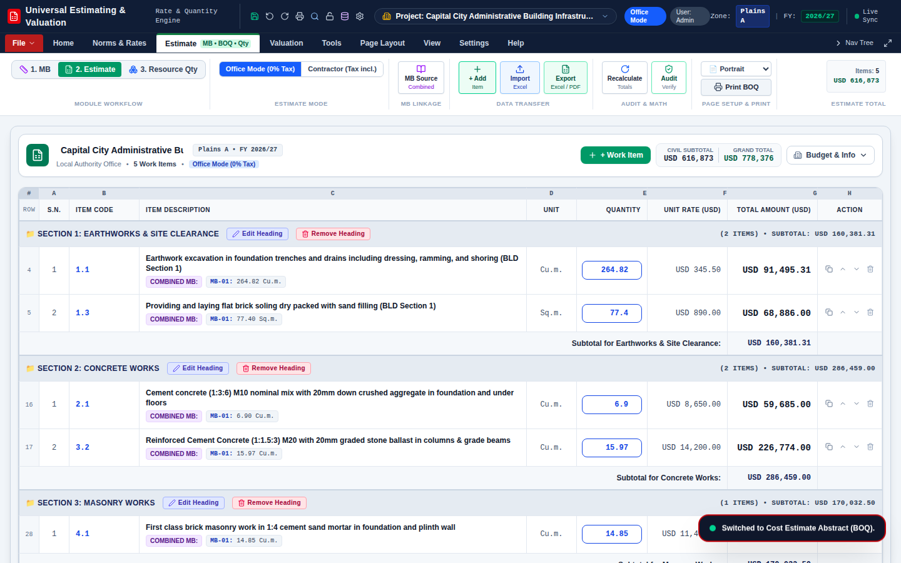
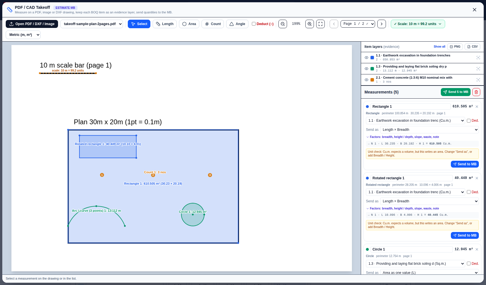
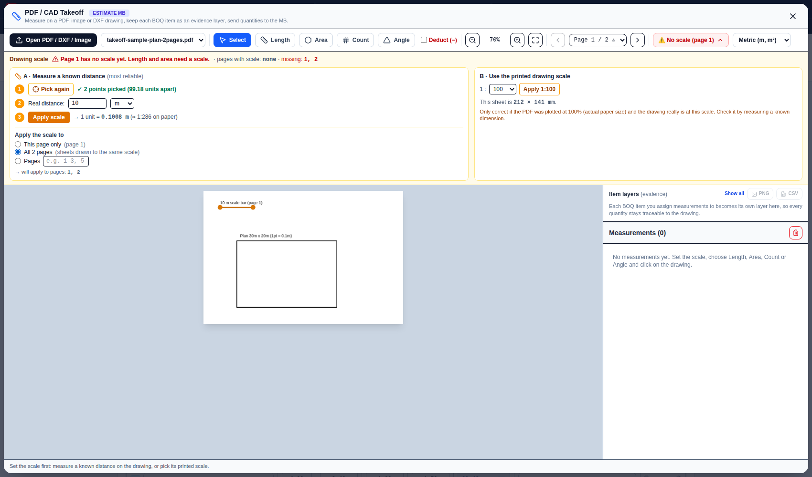
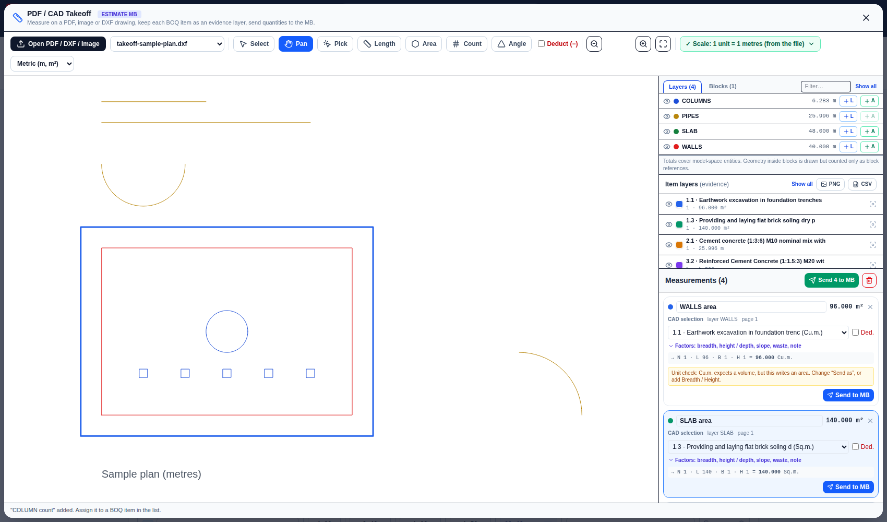
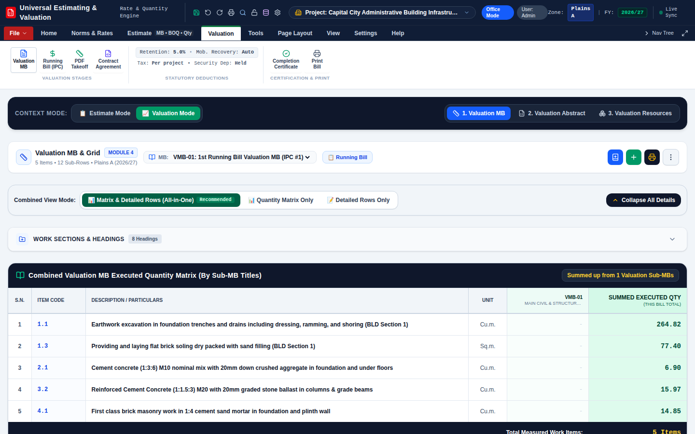

# Universal Estimating & Valuation

A web and desktop application for construction cost estimating and contract valuation. It works for any country, currency and measurement standard: rate analysis, norms libraries, Measurement Book (MB), Bill of Quantities (BOQ), interim payment certificates and completion certificates, all in English and fully offline-capable.

## Features

- **Norms & rate analysis** – Resource breakdowns (labor, material, equipment), percentage-based resources, overhead and profit, and one-click transfer of rates into the BOQ. Import or export norms as CSV/Excel.
- **Zone rates** – Rate schedules per zone/location and fiscal year, with labor and material multipliers and per-resource tax status (taxable / tax-exempt).
- **Two pricing modes** – Client estimate mode (material rates net of tax, tax applied on the taxable subtotal) and contractor mode (tax included in material rates).
- **Measurement Book (Estimate MB and Valuation MB)** – An empty (or text) No./L/B/H cell is skipped, a typed 0 multiplies (1 × 3 × 6 × empty = 18, 1 × 3 × 6 × 0 = 0). References follow their cells when rows or items are inserted, moved or deleted (a deleted target shows `#REF!` with a warning).
   – Excel-style cell linking: type `=` in a No./L/B/H/custom cell, click the cell you want to link (same item, another item, or an item's total quantity) and press Enter. Typed references work too: `=L1*2` (same item), `=I2.R1.L` (other item), `=I1.QTY/1000`, `=SUM(L1:L3)`. Linked cells update live. Plus custom dimension columns, deductions, precision and rounding settings.
- **BOQ / abstract of estimate** – Live quantity sync from the MB, contingency, tax, grand total, Excel and print output.
- **Valuation** – Valuation MB, Contract Setup (retention, advance and its recovery %, tender discount), Interim Payment Certificates (every percentage from the contract, advance recovery tracked across bills, true cumulative), Variation Orders and the completion certificate. Nothing is assumed: values that are not set show as 0 with a warning.
- **PDF / CAD takeoff** – Open a PDF, image or ASCII DXF drawing and measure on it, then send quantities straight into the Estimate MB or Valuation MB.
  - **Scale, always explicit:** set it from a known distance, a printed scale (1:n) or, for CAD, the drawing units; apply it to *this page only*, *all pages* or a *page range*. The scale in force is shown on every page, and the calibration line stays visible as a check.
  - **Shapes:** length (straight line, polyline, 3-point arc, freehand curve), area (rectangle, rotated rectangle, polygon, circle, ellipse, freehand), count and angle; deductions; perimeter and side dimensions are kept.
  - **Area your way:** send an area as one value, as perimeter, or as Length × Breadth, Breadth × Length or Length × Height; add breadth, height / depth, slope factor and waste %.
  - **Evidence layers:** every BOQ item becomes its own coloured layer (show / hide / isolate), saved with the drawing; export a PNG of the page with a legend, or a CSV of all measurements.
  - **CAD (DXF):** exact lengths and areas per layer, block counts, pick entities, snap to vertices; units read from the file.
- **Drawing tools** – Parametric template drawings, bar bending schedules and visual geometry-to-MB mapping.
- **AI assistant (optional)** – Gemini-backed norm suggestions and Q&A when `GEMINI_API_KEY` is set.
- **Local-first and offline** – Data is kept in the browser (SQLite via sql.js, with its engine bundled, plus localStorage); installable as a PWA with a service worker that needs no CDN. A *Saved* indicator and a backup-age chip sit in the header; **Backup → Full Backup & Restore** saves everything (projects, rates, MB and valuation rows, contract, bills, settings and takeoff drawings) in one file and restores it, taking a safety copy first. A storage-full failure is shown as NOT SAVED instead of being ignored.

## Screenshots

**Dashboard**



**Estimate Measurement Book** with live quantity matrix and measurement sub-rows



**Excel-style cell linking**: type `=`, click another cell (same item or another item), press Enter. Row badges (R1, R2, ...) show what you are linking to.



**Estimate / BOQ**



**PDF takeoff**: shapes, item evidence layers and live MB preview with a unit check



**Scale section**: pick two points on a known dimension, enter the real distance, then choose this page, all pages or a range



**CAD (DXF) takeoff**: layer totals, block counts, units from the file



**Valuation Measurement Book**



(The sample data in the screenshots is illustrative.)

## Configuration

All regional settings are user-configurable under **Settings → Display / Format**:

| Setting | Default | Notes |
|---|---|---|
| Currency | `USD` | Any code or symbol (EUR, GBP, JPY, INR, AED, ...). |
| Number system | International (1,234,567.89) | Optional South Asian grouping (12,34,567.89). |
| Tax rate | Per project (new projects: 10%) | Set to 0 for no tax. |
| Fiscal year | `YYYY/YY` | Free format, e.g. `2026/27`. |
| Dimension labels | `No., L, B, H` | Or full labels. |

Sample zones, rates, organizations and contractors included in the app are illustrative placeholders. Replace them with your own norms and rate schedules (CSV/Excel import is supported).

## Getting started

```bash
npm install
cp .env.example .env      # optional: add GEMINI_API_KEY
npm run dev               # http://localhost:3000
```

Other scripts: `npm test` (unit tests), `npm run lint` (type check), `npm run build` (production build), `npm start` (run the built server), `npm run desktop:build` (Electron installers via electron-builder).

## Project layout

```
src/            React + TypeScript application (components, modules, services, data, types)
server.ts       Express server (API routes, optional Gemini proxy, serves the app)
electron/       Optional desktop wrapper
public/         PWA manifest, service worker, icons
docs/           Specification documents
Optimization.md Prioritized roadmap and improvement backlog
```

## Data files

Project files use `.uep` and master templates use `.uet` (both JSON).

## Privacy

Everything runs locally unless you enable the optional AI assistant, which sends your prompt and limited project context to the Gemini API.

<<<<<<< HEAD
=======

>>>>>>> 5d3ce35fa467459b405a52fe693eb9e7e57f8f60
The app is fully client-side (data stays in the browser), so Pages is enough. The optional Gemini AI endpoints in `server.ts` need a Node host (Render, Railway, Fly.io); set `GEMINI_API_KEY` there as an environment variable, never in the repo.

## License

GNU General Public License v2.0. See [LICENSE](LICENSE).
