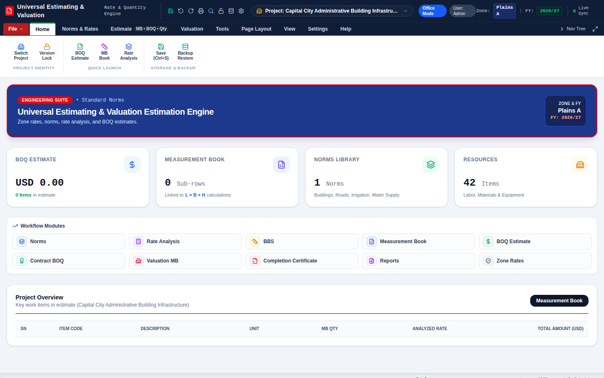
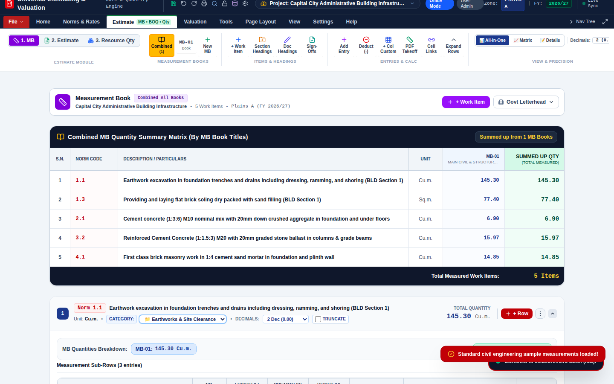
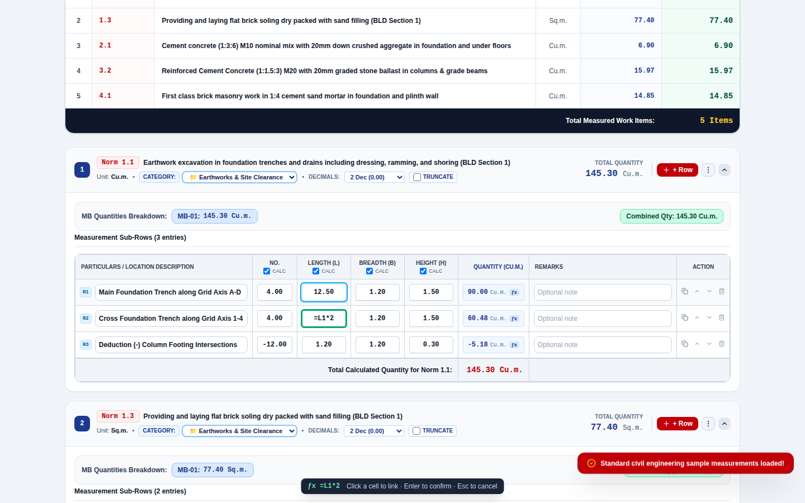
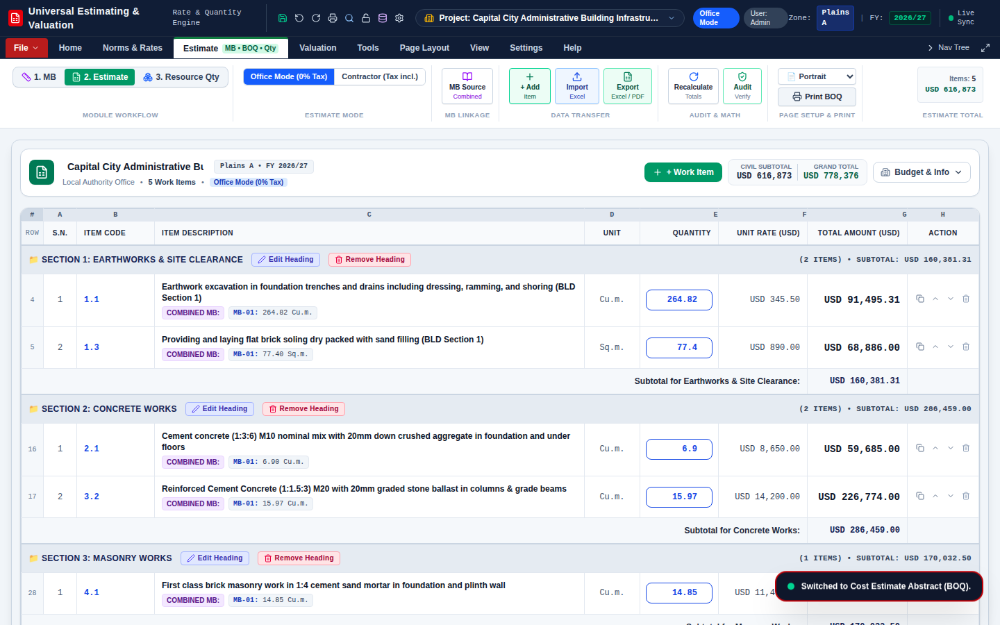
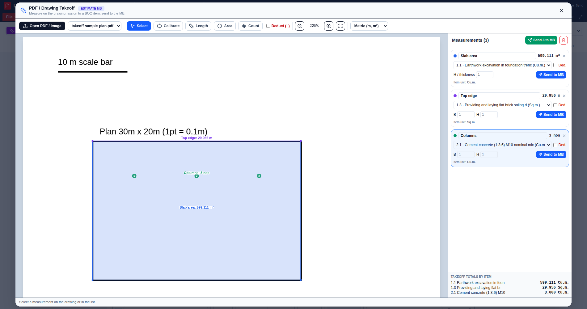
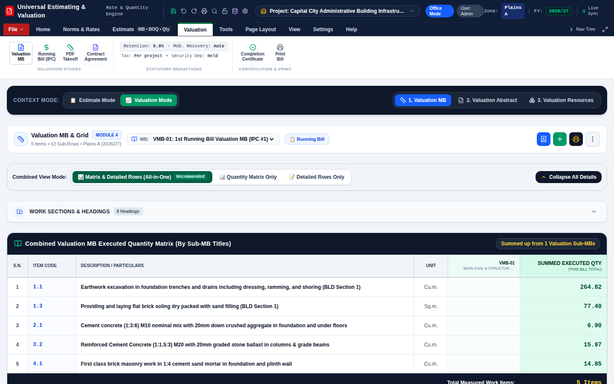

# Universal Estimating & Valuation

A web and desktop application for construction cost estimating and contract valuation. It works for any country, currency and measurement standard: rate analysis, norms libraries, Measurement Book (MB), Bill of Quantities (BOQ), interim payment certificates and completion certificates, all in English and fully offline-capable.

## Features

- **Norms & rate analysis** – Resource breakdowns (labor, material, equipment), percentage-based resources, overhead and profit, and one-click transfer of rates into the BOQ. Import or export norms as CSV/Excel.
- **Zone rates** – Rate schedules per zone/location and fiscal year, with labor and material multipliers and per-resource tax status (taxable / tax-exempt).
- **Two pricing modes** – Client estimate mode (material rates net of tax, tax applied on the taxable subtotal) and contractor mode (tax included in material rates).
- **Measurement Book (Estimate MB and Valuation MB)** – Excel-style cell linking: type `=` in a No./L/B/H/custom cell, click the cell you want to link (same item, another item, or an item's total quantity) and press Enter. Typed references work too: `=L1*2` (same item), `=I2.R1.L` (other item), `=I1.QTY/1000`, `=SUM(L1:L3)`. Linked cells update live. Plus custom dimension columns, deductions, precision and rounding settings.
- **BOQ / abstract of estimate** – Live quantity sync from the MB, contingency, tax, grand total, Excel and print output.
- **Valuation** – Valuation MB, contract setup, interim payment certificates (retention, advance recovery, tax), variation orders (component present, not yet linked in navigation) and completion certificate.
- **PDF / drawing takeoff** – Open a PDF or image, calibrate the scale, measure lengths, areas and counts (with deductions), assign them to BOQ items and send them straight into the Estimate MB or Valuation MB. Re-measure and push updates to the linked rows. Drawings stay in your browser.
- **Drawing tools** – Parametric template drawings, bar bending schedules and visual geometry-to-MB mapping.
- **AI assistant (optional)** – Gemini-backed norm suggestions and Q&A when `GEMINI_API_KEY` is set.
- **Local-first** – Data is kept in the browser (SQLite via sql.js / localStorage); installable as a PWA; optional Electron wrapper.

## Screenshots

**Dashboard**



**Estimate Measurement Book** with live quantity matrix and measurement sub-rows



**Excel-style cell linking**: type `=`, click another cell (same item or another item), press Enter. Row badges (R1, R2, ...) show what you are linking to.



**Estimate / BOQ**



**PDF / drawing takeoff**: calibrate the scale, measure lengths, areas and counts, assign to BOQ items and send to the MB



**Valuation Measurement Book**



(The sample data in the screenshots is illustrative.)

## Configuration

All regional settings are user-configurable under **Settings → Display / Format**:

| Setting | Default | Notes |
|---|---|---|
| Currency | `USD` | Any code or symbol (EUR, GBP, JPY, INR, AED, ...). |
| Number system | International (1,234,567.89) | Optional South Asian grouping (12,34,567.89). |
| Tax rate | Per project (new projects: 10%) | Set to 0 for no tax. |
| Fiscal year | `YYYY/YY` | Free format, e.g. `2026/27`. |
| Dimension labels | `No., L, B, H` | Or full labels. |

Sample zones, rates, organizations and contractors included in the app are illustrative placeholders. Replace them with your own norms and rate schedules (CSV/Excel import is supported).

## Getting started

```bash
npm install
cp .env.example .env      # optional: add GEMINI_API_KEY
npm run dev               # http://localhost:3000
```

Other scripts: `npm run lint` (type check), `npm run build` (production build), `npm start` (run the built server), `npm run desktop:build` (Electron installers via electron-builder).

## Project layout

```
src/            React + TypeScript application (components, modules, services, data, types)
server.ts       Express server (API routes, optional Gemini proxy, serves the app)
electron/       Optional desktop wrapper
public/         PWA manifest, service worker, icons
docs/           Specification documents
Optimization.md Prioritized roadmap and improvement backlog
```

## Data files

Project files use `.uep` and master templates use `.uet` (both JSON).

## Privacy

Everything runs locally unless you enable the optional AI assistant, which sends your prompt and limited project context to the Gemini API.

## Deploy: push to GitHub and it publishes itself

`.github/workflows/deploy.yml` type-checks, builds and publishes the app to GitHub Pages on every push to `main`.

One-time setup: in the GitHub repo open **Settings → Pages → Build and deployment → Source: GitHub Actions**. After that, `git add . && git commit -m "message" && git push` is all you need. The site appears at `https://<your-user>.github.io/<repo>/` (see the Actions tab for the run and the URL).

The app is fully client-side (data stays in the browser), so Pages is enough. The optional Gemini AI endpoints in `server.ts` need a Node host (Render, Railway, Fly.io); set `GEMINI_API_KEY` there as an environment variable, never in the repo.

## License

GNU General Public License v2.0. See [LICENSE](LICENSE).
